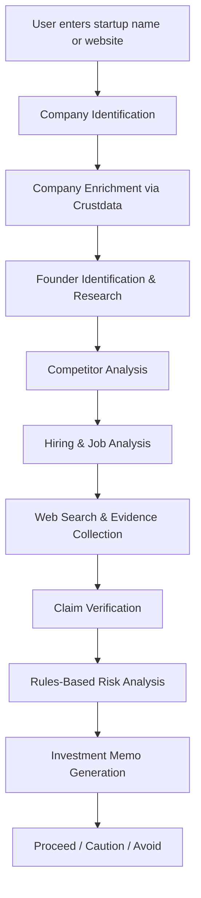

# DueDiligence AI 🔍
### Autonomous Startup Investment Research Agent

DueDiligence AI is an AI-powered research agent that automates startup investigation and investment due diligence. It collects company information, researches founders, analyzes competitors, examines hiring trends, verifies claims using web sources, and generates a structured investment memo with evidence-backed insights.

The goal is to reduce hours of manual research into minutes while helping investors make better-informed decisions.

---

## 🚀 Features

- **Automated Company Research** — Enriches startup information using Crustdata APIs.
- **Founder Intelligence** — Identifies founders and researches their professional backgrounds.
- **Competitor Analysis** — Identifies competitors and evaluates the competitive landscape.
- **Hiring & Growth Signals** — Analyzes job listings and hiring patterns to identify potential growth signals.
- **Web-Based Research** — Searches the internet and retrieves relevant information about startups.
- **Claim Verification** — Cross-checks important company claims against available evidence.
- **Risk Analysis** — Identifies potential investment risks using structured, rules-based analysis.
- **Investment Memo Generation** — Produces a comprehensive research report with supporting evidence and source URLs.
- **Investment Recommendation** — Generates one of three outcomes:
  - 🟢 Proceed
  - 🟡 Proceed with Caution
  - 🔴 Avoid

**Note:** The system assists investment research. Final investment decisions remain with human investors.

---

## 🏗️ Architecture

The project follows a sequential, multi-stage research pipeline.



---

## 🛠️ Tech Stack

| Component | Technology |
|---|---|
| Frontend | Next.js |
| Language | TypeScript |
| Styling | Tailwind CSS |
| Backend | Python |
| API Framework | FastAPI |
| Company Intelligence | Crustdata REST APIs |
| Web Research | Web Search & Fetch |
| Analysis | AI/LLM + Rules-Based Risk Engine |

---

## 📂 Project Structure

```text
DueDiligence-AI/
│
├── frontend/               # Next.js frontend
│   ├── app/               # Application pages
│   ├── components/         # Reusable UI components
│   └── ...
│
├── backend/                # FastAPI backend
│   ├── main.py             # API entry point
│   ├── ...                 # Research pipeline & services
│   └── ...
│
├── README.md
└── ...
```

---

## ⚙️ Installation & Setup

### Prerequisites

- Node.js and npm
- Python 3.10+
- Crustdata API key
- API credentials for the configured LLM and web research providers

### 1. Clone the repository

```bash
git clone <YOUR_REPOSITORY_URL>
cd <YOUR_PROJECT_DIRECTORY>
```

### 2. Configure the backend

```bash
cd backend
python -m venv venv
```

Activate the virtual environment:

**Windows (PowerShell)**
```powershell
.\venv\Scripts\Activate.ps1
```

**Linux / macOS**
```bash
source venv/bin/activate
```

Install dependencies:

```bash
pip install -r requirements.txt
```

Create a `.env` file in the backend directory:

```env
CRUSTDATA_API_KEY=your_crustdata_api_key
LLM_API_KEY=your_llm_api_key
WEB_SEARCH_API_KEY=your_web_search_api_key
```

Start the backend:

```bash
uvicorn main:app --reload
```

### 3. Configure the frontend

Open a new terminal:

```bash
cd frontend
npm install
```

Configure the frontend environment variables as required by the application.

Start the development server:

```bash
npm run dev
```

Open the local URL displayed in the terminal to access the application.

---

## 🔄 How It Works

1. **Input:** The user provides a startup name or website.
2. **Enrichment:** The system retrieves structured company information through Crustdata.
3. **Founder Research:** It identifies founders and gathers relevant professional information.
4. **Market Research:** It analyzes competitors, hiring activity, and available market signals.
5. **Evidence Collection:** It searches web sources and retrieves supporting information.
6. **Verification:** It checks up to three selected claims against available evidence.
7. **Risk Assessment:** It evaluates potential concerns using rules-based analysis.
8. **Report Generation:** It creates an investment memo with findings, evidence, risks, and a recommendation.

---

## 📊 Sample Investment Memo

A generated investment memo may contain:

- Company overview
- Founding team and background
- Market and competitive landscape
- Hiring and growth indicators
- Verified claims and supporting sources
- Potential risks and red flags
- Investment recommendation
- Evidence URLs and research references

### Recommendation Categories

| Recommendation | Meaning |
|---|---|
| **Proceed** | Available evidence supports further investment consideration. |
| **Proceed with Caution** | Potential concerns or information gaps require further investigation. |
| **Avoid** | Identified risks or negative signals warrant caution against proceeding. |

---

## 🧪 Testing

Backend tests:

```bash
pytest
```

Frontend checks:

```bash
npm run lint
npx tsc --noEmit
npm run build
```

---

## 🔮 Future Improvements

- Deeper financial statement analysis
- Startup valuation estimation
- Historical funding and investor analysis
- More comprehensive market sizing
- Multi-agent collaborative research
- Export investment memos to PDF
- Persistent research history and startup comparison
- Customizable investor evaluation criteria

---

## 🎯 Use Cases

- Venture capital firms
- Angel investors
- Startup accelerators
- Investment analysts
- Corporate venture capital teams
- Founders conducting competitive research

---

## 💡 Vision

To build an intelligent investment research assistant that makes startup due diligence faster, more transparent, and evidence-driven — allowing investors to focus on strategic decisions rather than hours of manual information gathering.

---

**Built for a hackathon | Powered by AI, Crustdata, and automated research**
